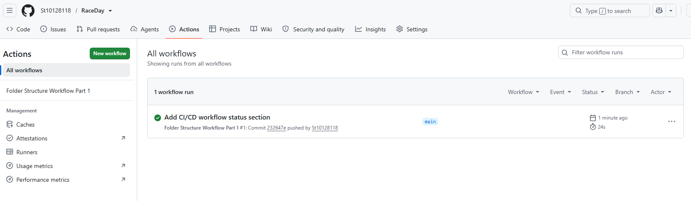

# RaceDay

RaceDay is an event management system for road races and other running events. It supports event organisers in creating and managing events, routes, categories, and participant enrolments, while providing participants with the information they need to register and track their race results.

## User Roles

### Event Organiser

Event organisers create and manage race events, configure routes and categories, set participant limits, and oversee enrolments and results.

### Participant

Participants browse available events, enrol in a suitable category, manage their registration details, and view their race results.

## CI/CD Screenshot

The screenshot below is evidence that the GitHub Actions folder structure workflow passed successfully.



## Running the backend locally

The backend targets .NET 10 LTS and uses SQL Server Express. Install the [.NET 10 SDK](https://dotnet.microsoft.com/download/dotnet/10.0) and make sure SQL Server Express is running; the Development connection string is in `backend\RaceDay.Api\appsettings.Development.json`.

```powershell
dotnet run --project backend\RaceDay.Api\RaceDay.Api.csproj
```

The API uses its Development launch profile and local SQL Server Express settings automatically, creates the database schema if it does not already exist, and opens Swagger at `http://localhost:5108/swagger`. It generates a temporary JWT key for local development; tokens expire when the API restarts.

**Visual Studio:** Open `RaceDay.sln`, choose `RaceDay.Api` in the startup-project dropdown if it is not already selected, then press the green Run button. The `RaceDay.Api` launch profile sets Development mode, launches the browser to Swagger, and uses the same local database settings.

Run the backend tests in another PowerShell window:

```powershell
dotnet test backend\RaceDay.Api.Tests\RaceDay.Api.Tests.csproj
```

For shared or deployed environments, configure a private `Jwt:Key` and a production database connection; the temporary development key and local SQL Server settings are not suitable for production.
