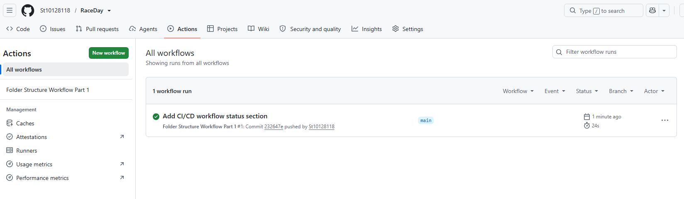

# RaceDay

RaceDay is an event management system for road races and other running events. It supports event organisers in creating and managing events, routes, categories, and participant enrolments, while providing participants with the information they need to register and track their race results.

## User Roles

### Event Organiser

Event organisers create and manage race events, configure routes and categories, set participant limits, and oversee enrolments and results.

### Participant

Participants browse available events, enrol in a suitable category, manage their registration details, and view their race results.

## CI/CD Screenshot

The screenshot below is evidence that the GitHub Actions folder structure workflow passed successfully.



## Running the backend locally

The backend targets .NET 10 LTS and uses SQL Server Express. Install the [.NET 10 SDK](https://dotnet.microsoft.com/download/dotnet/10.0) and make sure SQL Server Express is running; the Development connection string is in `backend\RaceDay.Api\appsettings.Development.json`.

```powershell
dotnet run --project backend\RaceDay.Api\RaceDay.Api.csproj --launch-profile RaceDay.Api
```

The `RaceDay.Api` profile uses Development mode and the local SQL Server Express settings, creates the database schema if it does not already exist, and opens Swagger at `http://localhost:5108/swagger`. It generates a temporary JWT key for local development; tokens expire when the API restarts.

**Visual Studio:** Open `RaceDay.sln`, select the `RaceDay.Api` project and its `RaceDay.Api` launch profile, then press **Run**.

Run the backend tests in another PowerShell window:

```powershell
dotnet test backend\RaceDay.Api.Tests\RaceDay.Api.Tests.csproj
```

For shared or deployed environments, configure a private `Jwt:Key` and a production database connection; the temporary development key and local SQL Server settings are not suitable for production.

## Running the MVC frontend locally

Start the backend API first using the `RaceDay.Api` profile above. In a second terminal, set the API URL and run the MVC app with its `http` profile:

```powershell
$env:RaceDayApi__BaseUrl = "http://localhost:5108"
dotnet run --project frontend\RaceDayMVCApp\RaceDayMVCApp.csproj --launch-profile http
```

The `http` profile opens the frontend at `http://localhost:5280`. The `https` profile uses `https://localhost:7165` (and also listens on HTTP port `5280`); trust the local HTTPS development certificate first if needed:

```powershell
dotnet dev-certs https --trust
$env:RaceDayApi__BaseUrl = "http://localhost:5108"
dotnet run --project frontend\RaceDayMVCApp\RaceDayMVCApp.csproj --launch-profile https
```

In Visual Studio, open `frontend\RaceDayMVCApp\RaceDayMVCApp.csproj`, select the `http` or `https` profile, and press **Run**. Add `"RaceDayApi__BaseUrl": "http://localhost:5108"` to that profile's `environmentVariables` in `frontend\RaceDayMVCApp\Properties\launchSettings.json` so the frontend connects to the API profile. Visual Studio 2022 17.14 does not support .NET 10; use the CLI with the .NET 10 SDK or Visual Studio 18+. The frontend calls the API for event, account, enrolment, and result data. Event forecasts come from Open-Meteo and may be unavailable more than 16 days before an event.
